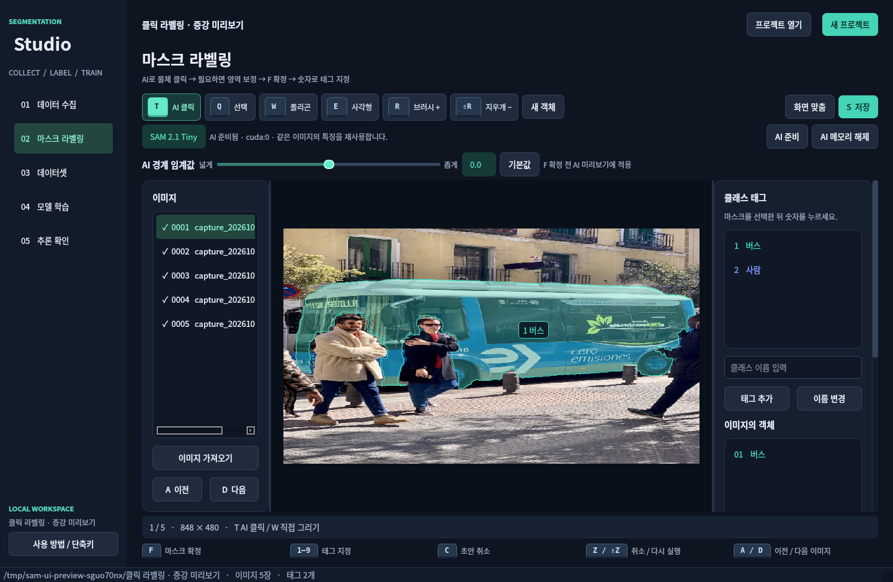
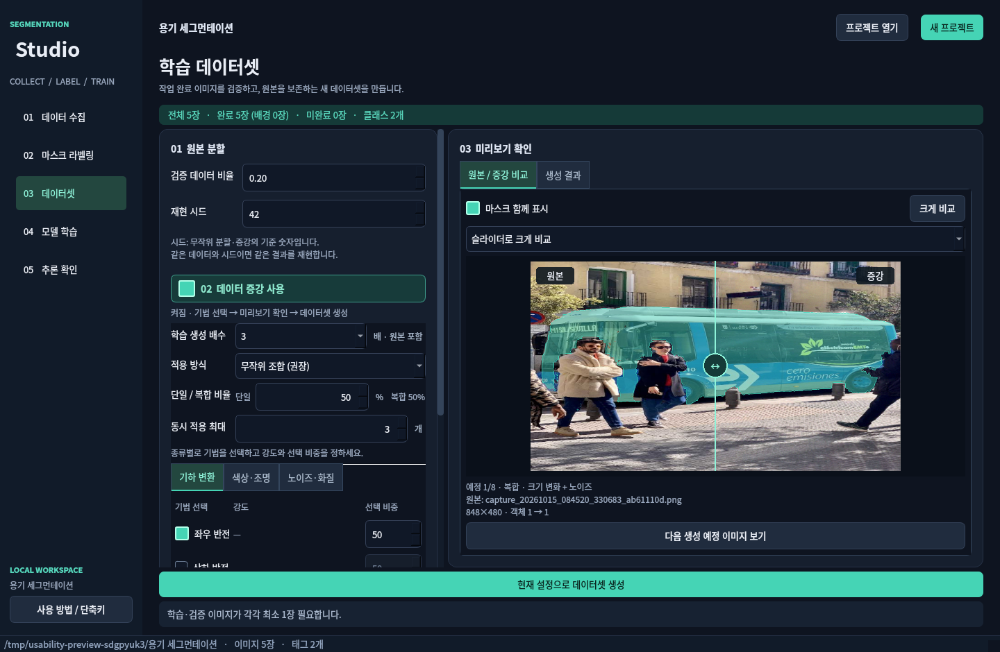
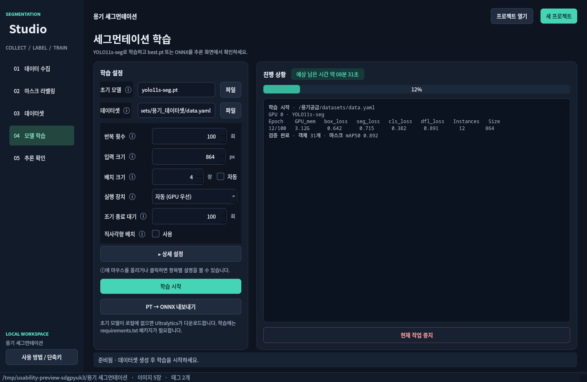
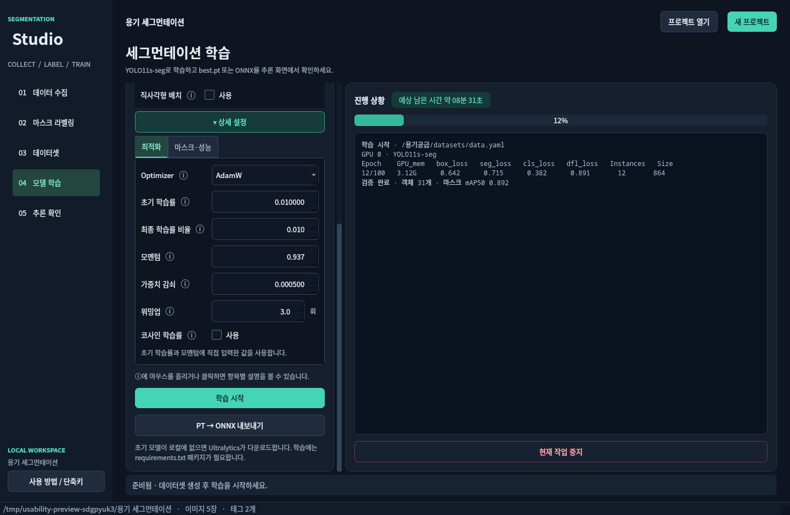

# Segmentation Studio

ZMQ 영상 수집 → 마스크 라벨링 → YOLO segmentation 데이터셋 → YOLO11s-seg 학습 → PT/ONNX 추론을 연결하는 한국어 데스크톱 프로그램입니다.


## 설치 및 실행

Python 3.10 이상을 사용하세요.

```bash
conda env create -f environment.yml
conda activate yolo
python app.py
```

학습 패키지 없이 수집·라벨링·데이터셋 기능만 사용하려면 `python -m pip install -r requirements-ui.txt`를 실행하세요. Qt는 PySide6를 우선 사용하고, 설치되어 있는 PyQt5도 지원합니다. GUI는 학습·추론을 요청하기 전까지 PyTorch/Ultralytics를 불러오지 않습니다.

> **PySide6 6.12.0은 사용하지 마세요.** 이 버전은 `QPainter` 메서드를 호출할 때마다 파이썬 `None`의 참조 수를 줄여서, 영상을 그리는 동안 `Fatal Python error: none_dealloc: deallocating None`으로 프로그램이 종료됩니다(6.11.2, 6.10.3, 6.9.3에서는 발생하지 않음을 확인). `requirements-ui.txt`가 이 버전을 제외합니다. 이미 설치했다면 `python -m pip install "PySide6!=6.12.0"`으로 낮추세요.

프로젝트를 바로 열 수도 있습니다.

```bash
python app.py --project /path/to/project
```

현재 Conda 환경은 다른 환경들과 같은 기본 경로 **`/home/nse/miniconda3/envs/yolo`**에 있습니다(Python 3.10.21). 기존 프로젝트 내부 환경과 `venv`는 제거했습니다. `conda env list`에서 이름 `yolo`로 확인하고 다음 명령으로 실행하세요.

```bash
conda activate yolo
python app.py
```

현재 설치된 주요 패키지는 **PyTorch `2.11.0+cu128`, torchvision `0.26.0+cu128`, Ultralytics `8.4.60`, PySide6 `6.11.2`**입니다. NumPy·OpenCV·PyZMQ·PyYAML·ONNX·ONNX Runtime·pytest와 하위 의존성도 설치되어 있습니다. 인터넷과 GPU 접근을 확인했고, RTX 5070 Laptop GPU에서 CUDA 행렬 연산·torchvision NMS 및 실제 `yolo11s-seg.pt`의 848×480 예제 이미지 추론(마스크 객체 6개)을 확인했습니다. 학습과 추론의 **실행 장치** 드롭다운에서 **GPU 0 (CUDA)**를 선택하면 GPU를 지정합니다. 기본 **자동 (GPU 우선)**은 CUDA가 있으면 GPU를 사용합니다.

환경 이동 후 테스트 43개와 `pip check`도 통과했습니다. 설치 상태와 버전은 `/home/nse/miniconda3/envs/yolo/environment-status.json`, `/home/nse/miniconda3/envs/yolo/installed-packages.txt`, GPU 확인 결과는 `/home/nse/miniconda3/envs/yolo/gpu-verification.json`에 기록했습니다. 새 환경을 만들 때는 `environment.yml`, GPU 패키지를 설치할 때는 `requirements-gpu.txt`를 사용할 수 있습니다. [PyTorch 공식 CUDA 12.8 조합](https://pytorch.org/get-started/previous-versions/)을 따릅니다.

## 사용 순서

1. **새 프로젝트**에서 비어 있는 폴더를 선택하세요. 기존 프로젝트는 `project.json`으로 엽니다.
2. **데이터 수집**에서 ZMQ 스트림 또는 **이미지 / 동영상 파일**을 선택합니다. 기본 ZMQ 주소는 `192.168.123.164:55555`이며 SUB/PULL/REQ와 bind/connect를 지원합니다. PNG/JPG/BMP/WebP/TIFF 이미지와 MP4/AVI/MOV/MKV/WebM 등의 동영상을 열 수 있습니다. 동영상은 재생·일시정지·위치 이동이 가능하며 Space로 한 장 촬영하거나 재생 중 N초 간격 자동 촬영을 합니다. 일시정지·위치 이동·재생 종료·입력 변경 시 자동 촬영을 중지합니다. 원본 파일은 변경하지 않고 현재 프레임을 프로젝트 PNG로 저장합니다.
3. **마스크 라벨링**에서 클래스 태그 이름을 등록합니다. **T AI 클릭**으로 물체 안쪽을 좌클릭하면 SAM 2.1 Tiny가 마스크를 만듭니다. 같은 물체에서 좌클릭은 포함, 우클릭 또는 Shift+좌클릭은 제외 포인트입니다. **F로 확정한 뒤 숫자로 태그**를 지정하세요. 예: `1 컵 / 2 병 / 3 상자`에서 숫자 2를 누르면 선택 객체가 병이 됩니다. W 폴리곤 등 수동 그리기와 원본 이미지 가져오기도 가능합니다.
4. 변경은 잠시 후 또는 이미지 이동 전에 자동 저장됩니다. 미완성 도형은 F로 완료하거나 C로 취소해야 이동할 수 있습니다. 객체가 없는 이미지만 **배경 이미지로 확인**을 체크하세요.
5. **데이터셋**에서 검증 비율/재현 시드를 정합니다. **데이터 증강 사용**을 켜고 생성 배수·증강 종류·강도·비율을 설정하세요. 실제 생성 예정 이미지와 변환된 마스크를 미리보기로 확인한 뒤 **현재 설정으로 데이터셋 생성**을 누릅니다. 미작업·태그 미지정 이미지는 제외됩니다. 최소 두 장의 완료 이미지가 필요합니다. 매번 별도 스냅샷을 만들며 원본과 이전 결과를 보존합니다.
6. **모델 학습**에서 데이터셋을 확인하고 반복 횟수·입력 크기·배치 크기·실행 장치를 설정하세요. 기본 모델은 `yolo11s-seg.pt`, 입력 크기 `864`, 배치 `4`, 장치 **자동 (GPU 우선)**입니다. 배치 옆 **자동**을 켜면 GPU 메모리 기준 자동 배치(`batch=-1`)를 사용합니다. **상세 설정**을 펼치면 optimizer·학습률·마스크 해상도 등을 변경할 수 있습니다. 모델이 로컬에 없으면 Ultralytics가 다운로드합니다.
7. 학습이 성공하면 best.pt가 **추론 확인**에 연결됩니다. **PT → ONNX 내보내기**도 별도로 실행할 수 있습니다. 학습과 내보내기는 별도 프로세스에서 진행되며 중지할 수 있습니다.
8. **추론 확인**에서 모델과 이미지·이미지 폴더·수집 화면 입력을 선택합니다. 수집 화면 입력은 ZMQ와 파일 미디어를 공유합니다. 마스크, 클래스, 신뢰도와 처리 시간을 표시합니다. 폴더는 이전/다음 이미지로 확인하고, 결과 PNG와 객체별 폴리곤 JSON을 저장할 수 있습니다. 설정을 바꾸면 시작 버튼으로 다시 적용하세요.

파일 선택창은 용도별 시작 위치를 사용합니다. 초기 모델은 앱의 가중치 폴더, 학습 결과 모델은 프로젝트 `runs`, 데이터셋은 `datasets`, 이미지·동영상 입력은 `images`, 프로젝트 열기는 현재 프로젝트의 상위 폴더를 우선합니다. 현재 입력한 파일이 있으면 그 폴더를 열고, 그 밖에는 프로젝트·용도별로 마지막 선택 위치를 기억합니다. 선택 취소는 기억한 위치를 변경하지 않습니다.

라벨링 캔버스의 휠 확대·축소 시 원본 픽셀 기준 배율을 약 1초간 표시합니다. `100%`는 이미지 1픽셀을 화면 1픽셀로 표시하는 배율입니다. **화면 맞춤 · 중앙**은 이미지를 화면에 맞추고 중앙으로 이동하며 진행 중인 화면 이동도 초기화합니다. 마스크는 변경하지 않습니다.

## 왼손 단축키

라벨링 캔버스에 포커스가 있을 때 동작합니다. 텍스트/숫자 입력 중에는 입력 내용을 바꾸거나 라벨을 잘못 지정하지 않습니다.

| 키 | 동작 |
| --- | --- |
| T | SAM2 AI 클릭 마스크 도구 |
| 좌클릭 / 우클릭·Shift+좌클릭 | AI 포함 포인트 / 제외 포인트 (같은 객체 보정) |
| Q / W / E | 선택·꼭짓점 이동 / 폴리곤 / 사각형 |
| R / Shift+R | 브러시 / 지우개 |
| F / C | 도형 완료 / 미완성 도형 취소 |
| 1–9 | 선택 객체에 해당 번호의 태그 지정 |
| Tab / Shift+Tab | 선택 객체의 다음 / 이전 태그 |
| X | 선택 객체 전체 삭제 |
| Z / Shift+Z | 실행 취소 / 다시 실행 (AI 초안에서는 포인트 취소 / 복구) |
| A / D | 이전 / 다음 이미지 |
| S / V | 저장 / 마스크 표시 전환 |
| Space+드래그 또는 마우스 가운데 버튼 | 화면 이동 |
| 휠 / Ctrl+휠 | 확대·축소 / 브러시 크기 |

Ctrl+S, Ctrl+Z, Ctrl+Shift+Z, Esc도 사용할 수 있습니다. 열 번째 이후 태그는 목록에서 클릭하세요. 브러시는 선택 마스크에 영역을 더하고, 지우개는 영역을 뺍니다. 원본 이미지는 바뀌지 않습니다. 브러시로 새 객체를 만들려면 **새 객체**를 누르세요. 폴리곤/사각형 도구 선택은 새 객체 그리기를 시작합니다.

수집 화면은 `Space` 한 장 촬영, `Ctrl+Space` 자동 촬영 시작/중지입니다. 수집 화면의 영상을 클릭하면 키보드 포커스가 이동합니다.

## SAM2로 빠르게 라벨링



T → 물체 안쪽 좌클릭 → 필요한 부분을 포함·제외 클릭 → F → 숫자 태그 순서입니다. 초록색 + 점은 포함, 분홍색 − 점은 제외입니다. 점선 마스크는 아직 저장되지 않은 초안이며 F로 확정해야 합니다. 최신 계산이 끝나기 전에는 확정하지 않습니다. C로 초안을 취소하거나 Z/Shift+Z로 포인트를 취소·복구할 수 있습니다.

빠진 영역이 크면 포함 클릭, 옆 물체가 섞이면 제외 클릭을 사용하세요. 작은 경계 오류는 **확정 후 R 브러시로 추가 / Shift+R 지우개로 제거**합니다. Ctrl+휠로 붓 크기를 조절하고 Z로 되돌립니다. 확정 뒤 T로 다음 물체를 클릭하면 별도 객체를 만듭니다. 기존 객체를 직접 보정할 때는 Q로 선택한 뒤 R/Shift+R을 사용합니다.

모델은 `models/sam2.1_t.pt`이고 기존 Ultralytics 패키지를 사용합니다. 파일이 없으면 첫 사용 때 공식 모델을 다운로드합니다. **AI 준비**로 미리 불러올 수 있으며 GPU를 자동 선택하고, CUDA가 없으면 CPU를 사용합니다. 이미지 특징은 같은 이미지의 후속 클릭에서 재사용합니다. 모델 준비/계산은 별도 스레드이며 빠른 연속 클릭은 최신 요청으로 합칩니다. 이미지 변경·C 취소 이후 도착한 결과는 무시합니다.

**AI 경계 임계값** 슬라이더는 -5.0~5.0(0.1 간격), 기본값은 0.0입니다. 왼쪽 음수는 포함 영역을 넓히고 오른쪽 양수는 줄입니다. F 확정 전 AI 초안을 다시 계산하며, 확정한 객체나 브러시로 수정한 마스크는 바꾸지 않습니다. 계산 중에는 이전 결과를 확정할 수 없습니다. 기본값 버튼으로 0.0으로 돌아갑니다.

객체 태그는 보이는 마스크 영역 가까이에 배지로 표시합니다. 오목하거나 떨어진 영역이 있는 마스크도 빈 바운딩 박스 모서리 대신 실제 마스크 영역을 기준으로 배치하고, 확대·이동과 화면 가장자리에서 잘리지 않게 제한합니다. 작은 가장자리 객체는 글자가 잘리지 않도록 배지를 안쪽으로 이동하므로 배지 중심이 마스크 밖에 위치할 수 있습니다.

**AI 메모리 해제**는 학습 전에 GPU 공간을 확보할 때 사용하세요. 확정한 마스크, 직접 그리는 중인 도형, AI 포인트·완료된 미리보기는 유지됩니다. 진행 중이던 AI 계산은 무효화되며 AI 준비로 다시 계산할 수 있습니다. 다운로드/로드 실패 시 수동 라벨링을 계속 사용할 수 있습니다. SAM2는 라벨링 보조이며 실제 학습 모델은 `yolo11s-seg.pt`입니다. [Ultralytics SAM2 API](https://docs.ultralytics.com/models/sam-2/).

## 데이터셋 증강



**데이터셋** 화면의 큰 **데이터 증강 사용** 체크박스를 켜세요. 체크박스 행 어디를 눌러도 켜고 끌 수 있습니다. 생성 배수는 **학습 원본 포함**입니다. ×2는 원본 1장 + 증강 1장, ×3은 원본 1장 + 증강 2장, ×4는 원본 1장 + 증강 3장입니다. 기본은 ×3이고 ×2~×10 또는 ×20을 선택할 수 있습니다. 학습 원본 80장을 ×3으로 만들면 학습 240장이 됩니다. 원본을 먼저 train/val로 나누고 **train에만** 증강을 추가하므로 검증 장수는 그대로 유지됩니다.

기법 선택은 **기하 변환 / 색상·조명 / 노이즈·화질** 탭으로 나눴습니다. 지원하는 변형은 좌우/상하 반전, 회전, 크기 변화, 위치 이동, 밝기·대비, 채도·색상, 노이즈, 약한 흐림입니다. 기법별 체크박스로 고르고 강도와 선택 비중을 설정하세요. 수치가 0이면 해당 변형은 꺼집니다. 초기 강도는 회전 ±10°, 크기 ±10%, 이동 ±5%, 밝기·대비·채도 ±15%입니다. 상하 반전과 흐림은 기본으로 선택하지 않습니다. 방향이나 색으로 구분하는 클래스는 관련 변형을 줄이세요.

적용 방식은 **한 가지씩 / 무작위 조합 / 선택한 기법 모두**입니다. 무작위 조합에서는 **단일/복합 비율**을 정할 수 있습니다. 예를 들어 추가 증강본 100장에 단일 40%를 지정하면 한 가지 기법 40장, 2개 이상 조합 60장으로 계획합니다. 실제 장수는 정수로 반올림하고 예정 장수를 화면에 표시합니다. 조합 최대는 기본 3개입니다. 한 기법만 선택하면 전부 단일로 생성합니다. 각 기법의 **선택 비중**은 상대값으로, 합계를 100으로 맞출 필요가 없으며 클수록 자주 선택됩니다. 모두 적용 모드에서는 선택 비중을 사용하지 않습니다.

**다음 생성 예정 이미지 보기**로 실제 학습 원본과 생성할 증강본을 비교합니다. **마스크 함께 표시**를 끄면 이미지 자체를 볼 수 있습니다. 표시한 미리보기는 해당 원본·설정·시드가 유지되면 저장되는 증강본과 동일합니다. 생성 보고서에도 이미지별 기법과 변환값, 기법별 적용 장수와 단일/복합 장수를 기록합니다. 이 작업 흐름은 [Roboflow의 증강 버전 생성 안내](https://roboflow.com/blog/image-segmentation-augment)를 참고했습니다.

미리보기의 기본 **슬라이더로 크게 비교**는 큰 이미지 위 분할선을 좌우로 드래그해 원본과 증강본을 비교합니다. **두 장 함께 보기**는 창 크기와 이미지 비율에 맞게 좌우 또는 위아래로 배치합니다. **크게 비교**로 더 큰 별도 창을 열 수 있고 이 창에서도 다음 생성 예정 이미지를 확인할 수 있습니다. 보고서는 **생성 결과** 탭으로 분리해 비교 공간을 확보했습니다.

**재현 시드**는 무작위 분할과 증강의 기준 숫자입니다. 같은 이미지 목록·설정·시드를 쓰면 동일한 학습/검증 분할과 증강 결과를 재현합니다. 보통 기본값 42를 유지하세요. 시드를 바꾸면 분할과 증강이 바뀔 수 있으며, 이미지를 추가하면 같은 시드여도 분할 결과가 달라질 수 있습니다.

이미지와 객체별 마스크를 함께 기하 변환한 뒤 YOLO 폴리곤을 다시 만듭니다. 출력은 848×480 등 원본 크기를 유지하며 원본 이미지/주석은 변경하지 않습니다. 경계 밖으로 사라지거나 너무 작아진 객체는 제거하고 보고서에 기록합니다. 검증 이미지는 원본 파일 그대로 복사합니다. 같은 seed·원본·설정은 같은 증강 결과를 만듭니다.

`report.json`의 `source_splits`에는 원본 분할, `augmentation`에는 설정·추가 장수·출처 이미지·변환값·사라진 객체가 기록됩니다. 증강을 끄면 기존처럼 원본만으로 생성합니다. 이 기능은 파일로 저장하는 데이터셋 증강이며, Ultralytics의 학습 중 온라인 증강은 기존 기본 설정대로 별도로 적용됩니다. [Ultralytics 증강 안내](https://docs.ultralytics.com/guides/yolo-data-augmentation/).

## 848×480 이미지와 잘린 물체



**진행 상황** 제목 옆에는 예상 남은 시간이 표시됩니다. 첫 epoch 완료 전에는 계산 중으로 표시하고, 이후 최근 최대 5개 epoch의 학습·검증 시간을 기준으로 1초마다 갱신합니다. 조기 종료하면 예상보다 빨리 끝날 수 있습니다. 학습 설정의 폭을 줄여 로그 공간을 넓혔고, 긴 로그 줄은 가로 스크롤로 확인합니다. 작업 프로세스의 UTF-8 출력을 글자 경계와 무관하게 이어서 디코딩하며 터미널 색상 코드·진행 줄을 정리합니다.

기본 화면은 반복 횟수(`epochs`), 입력 크기(`imgsz`), 배치(`batch`), 실행 장치(`device`), 조기 종료 대기(`patience`), 직사각형 배치(`rect`)를 제공합니다. 각 항목 옆 **ⓘ**에 마우스를 올리거나 클릭하면 의미·기본값·조절 기준을 확인할 수 있습니다. 숫자 입력칸에는 숫자만 표시하고 단위는 옆 라벨로 분리합니다. 증강 비율·강도·배수와 추론 입력 크기도 같은 방식을 사용합니다.

**상세 설정**은 처음에 접혀 있습니다. 펼치면 **최적화** 탭에서 optimizer, 초기 학습률(`lr0`), 최종 학습률 비율(`lrf`), 모멘텀, 가중치 감쇠, 워밍업, 코사인 학습률을 설정합니다. `optimizer=auto`는 초기 학습률과 모멘텀을 자동 결정하므로 해당 입력칸을 비활성화합니다. 직접 조절하려면 SGD·Adam·AdamW 등을 선택하세요. SGD의 모멘텀은 0보다 커야 합니다. **마스크·성능** 탭에는 마스크 축소 비율(`mask_ratio`), 겹친 마스크 병합, 혼합 정밀도(`amp`), 데이터 로더 작업 수(`workers`), 학습 시드가 있습니다. 상세 설정을 접어도 값은 유지되고 학습에 적용되며, 작업 폴더의 `config.json`에 기록됩니다. [Ultralytics 학습 설정](https://docs.ultralytics.com/modes/train/).



848×480을 그대로 저장하고 그 좌표계에서 라벨링합니다. 학습 크기는 `imgsz=864`를 기본으로 제안하며 비율 유지 resize와 패딩은 Ultralytics가 수행합니다. `640` 등 다른 32의 배수도 선택할 수 있습니다. `rect`는 직사각형 학습 배치를 사용합니다. 큰 imgsz는 메모리와 처리 시간을 더 사용하므로 실제 validation 결과와 GPU 메모리로 결정하세요.

화면 밖으로 잘렸어도 클래스를 구분할 수 있으면 **보이는 부분만** 마스크로 지정하세요. 화면 밖/다른 물체 뒤의 모양을 추측해서 채우지 않습니다. 판단이 어려운 이미지는 작업 중으로 남겨 학습에서 제외하세요.

## 파일과 지원 범위

- `project.json`: 클래스와 연결 설정. 화면 번호는 1부터, 학습 클래스 ID는 0부터입니다.
- `images/`: 원본 해상도의 PNG. 파일명 충돌을 방지합니다.
- `annotations/`, `masks/`: 객체별 주석과 이진 마스크. 저장은 원자적 파일 교체를 사용합니다. 과거 마스크 리비전은 복구 가능성을 위해 보존하므로 반복 편집 시 저장 공간이 늘어날 수 있습니다.
- `datasets/<ID>/`: images/train·val, labels/train·val, data.yaml, 생성 보고서. 라벨은 `class x1 y1 x2 y2 ...`입니다.
- `runs/<ID>/`: 작업 설정, 로그 출력, best.pt 및 ONNX. 중지/실패를 성공과 구분합니다.
- `predictions/`: 추론 시각화 PNG와 객체별 결과 JSON.

ZMQ는 JPEG/PNG 바이트 또는 마지막 파트가 해당 이미지인 multipart 메시지를 지원합니다. pickle/raw 배열 전송에는 별도 디코더가 필요합니다. 앱은 PUB 접속 요청 성공과 실제 프레임 수신을 구분합니다.

PT와 ONNX는 Ultralytics **instance segmentation** 모델을 지원합니다. ONNX는 `task=segment` 메타데이터가 필요하며 Ultralytics를 통해 ONNX Runtime으로 실행합니다. 임의 구조의 ONNX나 검출 전용 모델은 지원하지 않습니다. 내보내기 기본값은 고정 864×864, opset 17, NMS 미포함입니다. 동적/직사각형 내보내기 UI는 현재 제공하지 않습니다.

YOLO 폴리곤은 내부 구멍을 표현하지 못합니다. 데이터셋 생성 시 구멍은 채워지고, 분리된 영역은 개별 인스턴스로 내보냅니다. 해당 이미지와 변환 수를 보고서에 표시하며 원본 이진 마스크는 보존합니다.

## CLI

```bash
python scripts/collect.py --host 192.168.123.164 --interval 2 --auto
python scripts/train.py --project /path/to/project --model yolo11s-seg.pt --imgsz 864 --device 0
python scripts/infer_segment.py --model best.pt --source image.png
python scripts/infer_segment.py --model best.onnx --source zmq --host 192.168.123.164
```

기존 `scripts/infer_onnx.py`는 검출 전용 도구로 남겨 두었습니다. 마스크 확인에는 앱 또는 `infer_segment.py`를 사용하세요. 기존 raw 폴더의 폴리곤 라벨로 학습하려면 `scripts/train.py --raw data/raw`를 사용할 수 있습니다. 사각형 검출 라벨은 세그먼테이션 학습에서 거부합니다.

`infer_segment.py --save 결과폴더`는 그 아래에 고유한 `prediction_<ID>` 폴더를 만들어 저장합니다. 입력 폴더와 같은 경로를 선택해도 원본을 덮어쓰지 않습니다.

## 검증

```bash
QT_QPA_PLATFORM=offscreen PYTEST_DISABLE_PLUGIN_AUTOLOAD=1 python -m pytest -q
/usr/bin/python3 -m compileall -q app.py studio scripts tests
```

실제 ZMQ 송신기 접속, 데이터셋 학습과 ONNX 모델 실행은 별도 실기 검증이 필요합니다. 사전 학습된 YOLO11s-seg의 앱 PT 추론과 SAM 2.1 Tiny의 포함·제외 클릭 추론은 RTX 5070 GPU에서 확인했습니다. PySide6 offscreen으로 캔버스·전체 창, 저장/복원, 학습 데이터 증강과 모델/작업 오류 처리를 검사합니다. ZMQ 자동 테스트의 외부 전송 계층은 대체하며 이미지 디코딩은 실제 OpenCV를 사용합니다.

현재 자동 테스트는 PySide6에서 통과한 **139개**이며, SAM 초안·포인트 보정·경계 슬라이더·취소·저장·오류 복구, 마스크 내부 태그 배치, 증강 활성화 마우스 클릭·배수·기법 비중·단일/복합 비율·미리보기와 생성 픽셀 일치·마스크 정합·재현성·검증 데이터 분리·생성 중 주석 변경 감지, 데이터셋 결과 전달과 학습 프로세스 실패 처리, 숫자·단위 분리, 상세 설정 접기·값 유지, 학습 파라미터 검증과 Ultralytics 전달, 장치 변경 시 추론 결과 무효화, 한글 로그 분할 디코딩·ETA, 실제 PNG/MP4 열기·재생·촬영·탐색·EOF, 파일 교체 시 추론 입력 갱신, 배율·중앙 복귀, 큰 비교 보기, 파일 선택창 기본 경로·기억을 포함합니다. 새 가상환경에서 테스트하려면 `python -m pip install pytest`도 실행하세요.

API 동작 참고: [Ultralytics 학습](https://docs.ultralytics.com/modes/train), [세그먼테이션](https://docs.ultralytics.com/tasks/segment), [예측](https://docs.ultralytics.com/modes/predict).
