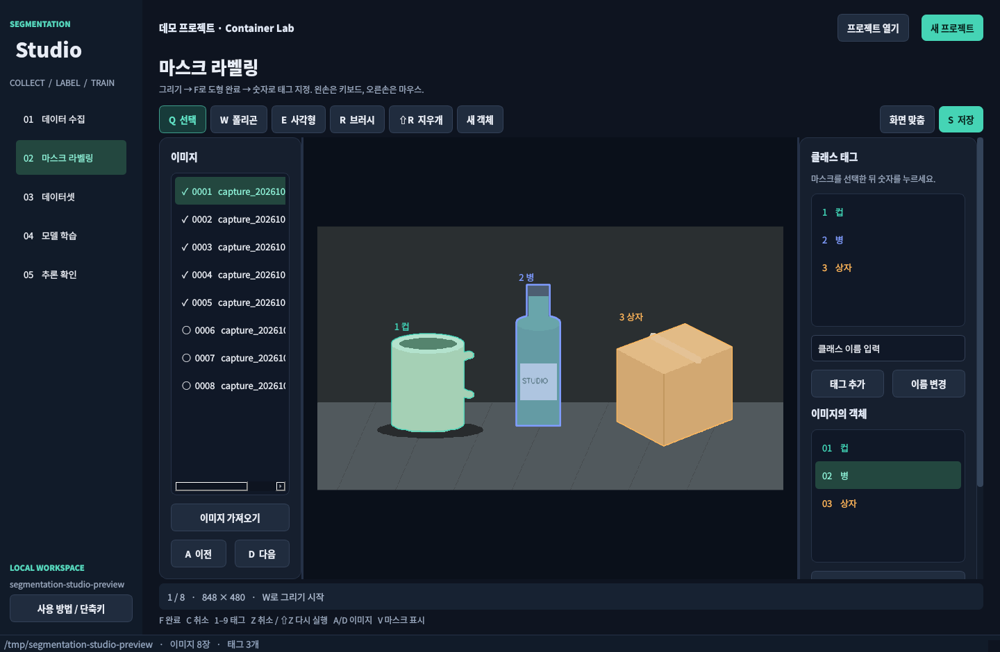

# Segmentation Studio

ZMQ 영상 수집 → 마스크 라벨링 → YOLO segmentation 데이터셋 → YOLO11s-seg 학습 → PT/ONNX 추론을 연결하는 한국어 데스크톱 프로그램입니다.



## 설치 및 실행

Python 3.10 이상을 사용하세요.

```bash
conda env create -f environment.yml
conda activate yolo
python app.py
```

학습 패키지 없이 수집·라벨링·데이터셋 기능만 사용하려면 `python -m pip install -r requirements-ui.txt`를 실행하세요. Qt는 PySide6를 우선 사용하고, 설치되어 있는 PyQt5도 지원합니다. GUI는 학습·추론을 요청하기 전까지 PyTorch/Ultralytics를 불러오지 않습니다.

프로젝트를 바로 열 수도 있습니다.

```bash
python app.py --project /path/to/project
```

현재 Conda 환경은 다른 환경들과 같은 기본 경로 **`/home/nse/miniconda3/envs/yolo`**에 있습니다(Python 3.10.21). 기존 프로젝트 내부 환경과 `venv`는 제거했습니다. `conda env list`에서 이름 `yolo`로 확인하고 다음 명령으로 실행하세요.

```bash
conda activate yolo
python app.py
```

현재 설치된 주요 패키지는 **PyTorch `2.11.0+cu128`, torchvision `0.26.0+cu128`, Ultralytics `8.4.60`, PySide6 `6.12.0`**입니다. NumPy·OpenCV·PyZMQ·PyYAML·ONNX·ONNX Runtime·pytest와 하위 의존성도 설치되어 있습니다. 인터넷과 GPU 접근을 확인했고, RTX 5070 Laptop GPU에서 CUDA 행렬 연산·torchvision NMS 및 실제 `yolo11s-seg.pt`의 848×480 예제 이미지 추론(마스크 객체 6개)을 확인했습니다. 학습과 추론 설정의 device를 `0`으로 선택하면 GPU를 사용합니다.

환경 이동 후 테스트 43개와 `pip check`도 통과했습니다. 설치 상태와 버전은 `/home/nse/miniconda3/envs/yolo/environment-status.json`, `/home/nse/miniconda3/envs/yolo/installed-packages.txt`, GPU 확인 결과는 `/home/nse/miniconda3/envs/yolo/gpu-verification.json`에 기록했습니다. 새 환경을 만들 때는 `environment.yml`, GPU 패키지를 설치할 때는 `requirements-gpu.txt`를 사용할 수 있습니다. [PyTorch 공식 CUDA 12.8 조합](https://pytorch.org/get-started/previous-versions/)을 따릅니다.

## 사용 순서

1. **새 프로젝트**에서 비어 있는 폴더를 선택하세요. 기존 프로젝트는 `project.json`으로 엽니다.
2. **데이터 수집**에서 기본 주소 `192.168.123.164:55555`에 연결합니다. SUB/PULL/REQ와 bind/connect를 선택할 수 있습니다. 버튼/Space로 한 장 촬영하거나 N초 간격 자동 촬영을 시작하세요. 유효한 새 프레임이 없으면 자동 촬영하지 않습니다.
3. **마스크 라벨링**에서 클래스 태그 이름을 등록합니다. 원본 이미지 가져오기도 가능합니다. 마스크를 그린 뒤 F로 도형을 완료하고 숫자로 태그를 지정하세요. 예: `1 컵 / 2 병 / 3 상자`에서 숫자 2를 누르면 선택 객체가 병이 됩니다. 기존 객체도 선택 후 숫자로 변경할 수 있습니다.
4. 변경은 잠시 후 또는 이미지 이동 전에 자동 저장됩니다. 미완성 도형은 F로 완료하거나 C로 취소해야 이동할 수 있습니다. 객체가 없는 이미지만 **배경 이미지로 확인**을 체크하세요.
5. **데이터셋**에서 검증 비율/seed를 정하고 생성합니다. 미작업·태그 미지정 이미지는 제외됩니다. 최소 두 장의 완료 이미지가 필요합니다. 매번 별도 스냅샷을 만들며 원본과 이전 결과를 보존합니다.
6. **모델 학습**에서 데이터셋을 확인하고 epoch/batch/device를 설정하세요. 기본 모델은 `yolo11s-seg.pt`, 학습 크기는 `864`, batch는 `4`, device는 `cpu`입니다. CUDA 환경은 device에 `0`을 입력하세요. batch `-1`은 자동 설정입니다. 모델이 로컬에 없으면 Ultralytics가 다운로드합니다.
7. 학습이 성공하면 best.pt가 **추론 확인**에 연결됩니다. **PT → ONNX 내보내기**도 별도로 실행할 수 있습니다. 학습과 내보내기는 별도 프로세스에서 진행되며 중지할 수 있습니다.
8. **추론 확인**에서 모델과 이미지·이미지 폴더·ZMQ 입력을 선택합니다. 마스크, 클래스, 신뢰도와 처리 시간을 표시합니다. 폴더는 이전/다음 이미지로 확인하고, 결과 PNG와 객체별 폴리곤 JSON을 저장할 수 있습니다. 설정을 바꾸면 시작 버튼으로 다시 적용하세요.

## 왼손 단축키

라벨링 캔버스에 포커스가 있을 때 동작합니다. 텍스트/숫자 입력 중에는 입력 내용을 바꾸거나 라벨을 잘못 지정하지 않습니다.

| 키 | 동작 |
| --- | --- |
| Q / W / E | 선택·꼭짓점 이동 / 폴리곤 / 사각형 |
| R / Shift+R | 브러시 / 지우개 |
| F / C | 도형 완료 / 미완성 도형 취소 |
| 1–9 | 선택 객체에 해당 번호의 태그 지정 |
| Tab / Shift+Tab | 선택 객체의 다음 / 이전 태그 |
| X | 선택 객체 전체 삭제 |
| Z / Shift+Z | 실행 취소 / 다시 실행 |
| A / D | 이전 / 다음 이미지 |
| S / V | 저장 / 마스크 표시 전환 |
| Space+드래그 또는 마우스 가운데 버튼 | 화면 이동 |
| 휠 / Ctrl+휠 | 확대·축소 / 브러시 크기 |

Ctrl+S, Ctrl+Z, Ctrl+Shift+Z, Esc도 사용할 수 있습니다. 열 번째 이후 태그는 목록에서 클릭하세요. 브러시는 선택 마스크에 영역을 더하고, 지우개는 영역을 뺍니다. 원본 이미지는 바뀌지 않습니다. 브러시로 새 객체를 만들려면 **새 객체**를 누르세요. 폴리곤/사각형 도구 선택은 새 객체 그리기를 시작합니다.

수집 화면은 `Space` 한 장 촬영, `Ctrl+Space` 자동 촬영 시작/중지입니다. 수집 화면의 영상을 클릭하면 키보드 포커스가 이동합니다.

## 848×480 이미지와 잘린 물체

848×480을 그대로 저장하고 그 좌표계에서 라벨링합니다. 학습 크기는 `imgsz=864`를 기본으로 제안하며 비율 유지 resize와 패딩은 Ultralytics가 수행합니다. `640` 등 다른 32의 배수도 선택할 수 있습니다. `rect`는 직사각형 학습 배치를 사용합니다. 큰 imgsz는 메모리와 처리 시간을 더 사용하므로 실제 validation 결과와 GPU 메모리로 결정하세요.

화면 밖으로 잘렸어도 클래스를 구분할 수 있으면 **보이는 부분만** 마스크로 지정하세요. 화면 밖/다른 물체 뒤의 모양을 추측해서 채우지 않습니다. 판단이 어려운 이미지는 작업 중으로 남겨 학습에서 제외하세요.

## 파일과 지원 범위

- `project.json`: 클래스와 연결 설정. 화면 번호는 1부터, 학습 클래스 ID는 0부터입니다.
- `images/`: 원본 해상도의 PNG. 파일명 충돌을 방지합니다.
- `annotations/`, `masks/`: 객체별 주석과 이진 마스크. 저장은 원자적 파일 교체를 사용합니다. 과거 마스크 리비전은 복구 가능성을 위해 보존하므로 반복 편집 시 저장 공간이 늘어날 수 있습니다.
- `datasets/<ID>/`: images/train·val, labels/train·val, data.yaml, 생성 보고서. 라벨은 `class x1 y1 x2 y2 ...`입니다.
- `runs/<ID>/`: 작업 설정, 로그 출력, best.pt 및 ONNX. 중지/실패를 성공과 구분합니다.
- `predictions/`: 추론 시각화 PNG와 객체별 결과 JSON.

ZMQ는 JPEG/PNG 바이트 또는 마지막 파트가 해당 이미지인 multipart 메시지를 지원합니다. pickle/raw 배열 전송에는 별도 디코더가 필요합니다. 앱은 PUB 접속 요청 성공과 실제 프레임 수신을 구분합니다.

PT와 ONNX는 Ultralytics **instance segmentation** 모델을 지원합니다. ONNX는 `task=segment` 메타데이터가 필요하며 Ultralytics를 통해 ONNX Runtime으로 실행합니다. 임의 구조의 ONNX나 검출 전용 모델은 지원하지 않습니다. 내보내기 기본값은 고정 864×864, opset 17, NMS 미포함입니다. 동적/직사각형 내보내기 UI는 현재 제공하지 않습니다.

YOLO 폴리곤은 내부 구멍을 표현하지 못합니다. 데이터셋 생성 시 구멍은 채워지고, 분리된 영역은 개별 인스턴스로 내보냅니다. 해당 이미지와 변환 수를 보고서에 표시하며 원본 이진 마스크는 보존합니다.

## CLI

```bash
python scripts/collect.py --host 192.168.123.164 --interval 2 --auto
python scripts/train.py --project /path/to/project --model yolo11s-seg.pt --imgsz 864 --device 0
python scripts/infer_segment.py --model best.pt --source image.png
python scripts/infer_segment.py --model best.onnx --source zmq --host 192.168.123.164
```

기존 `scripts/infer_onnx.py`는 검출 전용 도구로 남겨 두었습니다. 마스크 확인에는 앱 또는 `infer_segment.py`를 사용하세요. 기존 raw 폴더의 폴리곤 라벨로 학습하려면 `scripts/train.py --raw data/raw`를 사용할 수 있습니다. 사각형 검출 라벨은 세그먼테이션 학습에서 거부합니다.

`infer_segment.py --save 결과폴더`는 그 아래에 고유한 `prediction_<ID>` 폴더를 만들어 저장합니다. 입력 폴더와 같은 경로를 선택해도 원본을 덮어쓰지 않습니다.

## 검증

```bash
QT_QPA_PLATFORM=offscreen PYTEST_DISABLE_PLUGIN_AUTOLOAD=1 python -m pytest -q
/usr/bin/python3 -m compileall -q app.py studio scripts tests
```

실제 ZMQ 송신기 접속, 데이터셋 학습과 ONNX 모델 실행은 별도 실기 검증이 필요합니다. 사전 학습된 YOLO11s-seg의 앱 PT 추론은 RTX 5070 GPU에서 확인했습니다. Qt5 offscreen으로 캔버스·전체 창, 저장/복원과 데이터셋 생성, 모델/작업 오류 처리를 검사합니다. ZMQ 소켓 테스트는 pyzmq 부재로 외부 전송 계층을 대체하며 이미지 디코딩은 실제 OpenCV를 사용합니다.

현재 자동 테스트는 PySide6에서 통과한 43개이며, 데이터셋 작업 스레드에서 학습 화면으로 결과를 전달하는 과정과 별도 학습 프로세스의 실패 처리도 검사합니다. 새 가상환경에서 테스트하려면 `python -m pip install pytest`도 실행하세요.

API 동작 참고: [Ultralytics 학습](https://docs.ultralytics.com/modes/train), [세그먼테이션](https://docs.ultralytics.com/tasks/segment), [예측](https://docs.ultralytics.com/modes/predict).
